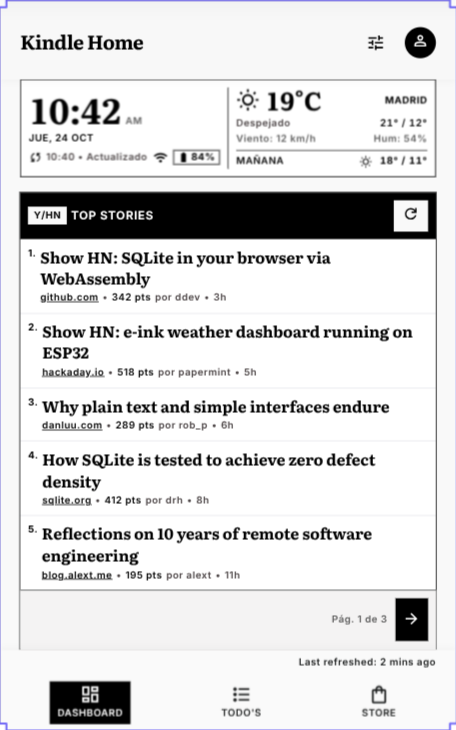

# Kindle Home (KOReader plugin)

[](https://github.com/miguehm/kindle-homepage/actions/workflows/ci.yml)
[License: MIT](LICENSE)

A KOReader homepage plugin built for Kindle e-ink devices. It shows the time,
device status and weather on one screen, plus a paginated **Top Stories** list
of Hacker News items delivered by the hnmd service.
Articles are saved as Markdown and read offline in KOReader's native reader.



## Features

- Clock (12/24 h), battery/network status and current weather with wind,
  humidity and tomorrow's high/low (Open-Meteo).
- Hacker News Top Stories with configurable rows per page, in-card refresh and
  session page memory.
- Offline reading: articles stream to `.md` files and open in KOReader's native
  reader (selection, annotations, progress, dictionary, night mode).
- Cache-first with stale fallback; timeouts, byte caps and typed errors for
  unreliable WiFi.
- Dashboard built from native widgets that fit one screen, with a native
  scroll container only as a measured last resort.

## Quickstart

1. Download the latest `kindlehome.koplugin-v*.zip` from
   [Releases](https://github.com/miguehm/kindle-homepage/releases).
2. Extract the `kindlehome.koplugin/` directory into
   `/mnt/us/koreader/plugins/` on your Kindle.
3. **Restart KOReader** (required on Kindle for new plugins to load).
4. Open **Tools → Kindle Home**.

To install from a checkout instead, copy `kindlehome.koplugin/` to the same
plugins directory and restart KOReader.

## Prerequisites

- A Kindle running KOReader (the target platform; Lua 5.1 / LuaJIT).
- Optional: an hnmd API key if your hnmd server requires one. The default
  endpoint is `https://hnmd.miguehm.com/v1`; it can be changed in settings.
- Weather needs either a configured place or latitude/longitude. Open-Meteo
  does not require an API key.
- Desktop KOReader is useful for iteration but is **not** a supported target.

## Configuration

Everything is configurable from the gear button in the dashboard, which opens
a native full-screen settings menu: Weather, Hacker News, Interface, Refresh
and network, and Paths and storage. Advanced users can edit the settings file
KOReader writes at `<settings dir>/kindlehome.lua` while KOReader is closed.

| Setting | Default | Meaning |
| --- | --- | --- |
| `hnmd_base_url` | `https://hnmd.miguehm.com/v1` | hnmd API base URL (https only) |
| `hnmd_api_key` | empty | Bearer token; masked in the UI, never logged |
| `hnmd_max_items` | `10` | Items requested from `/v1/top` (1–20) |
| `hn_items_per_page` | `4` | Preferred Top Stories rows (1–10, degrades to fit) |
| `weather_enabled`, `hnmd_enabled` | `true` | Enable each section |
| `weather_lat`, `weather_lon`, `weather_place_name` | unset | Weather location |
| `refresh_on_open` | `false` | Refresh in the background when opening |
| `refresh_budget_s`, `http_timeout_s` | `20`, `6` | Refresh budget and request timeout |
| `index_max_bytes`, `article_max_bytes` | 128 KiB, 512 KiB | Download byte caps |
| `ui_font_scale`, `ui_clock_24h`, `ui_fullscreen` | `1.0`, `false`, `true` | Interface |
| `storage_mode`, `documents_subdir` | `documents`, `KindleHome` | Content root |
| `custom_content_dir` | empty | Optional absolute content folder override |

### Storage

- Content root: a custom absolute folder if set, otherwise
  `<documents>/KindleHome` (on Kindle, `/mnt/us/documents/KindleHome`) or
  `<DataDir>/news/kindlehome` with `storage_mode = "datadir"`.
- Hacker News articles: `<content root>/articles/hn/<id>-<slug>.md`. Only
  Markdown is persisted there; the HTML needed by the reader is rendered to
  `<DataDir>/cache/kindlehome/articles/` and deleted when the reader closes.
- Cache: `<DataDir>/cache/kindlehome/*.json`, with a versioned envelope.
  Corrupt or incompatible cache is quarantined and regenerated.

## Usage

- Tap a headline to download (if needed) and open its Markdown article. If no
  body is available, a persistent link card opens with the HN discussion and
  source URLs so they can be copied or opened manually.
- Top Stories keeps its page for the KOReader session; an explicit refresh
  returns to page 1. Restarting KOReader also starts at page 1.
- HN and source URLs are real links in the document; Markdown images become
  clickable alt-text links and are never fetched implicitly.
- The **Kindle Home** Dispatcher action (`kindlehome_show_dashboard`) can be
  assigned to a gesture or Profile.

### Troubleshooting

| Symptom | What to do |
| --- | --- |
| No menu entry | Folder must be `kindlehome.koplugin` directly under `plugins/`; restart KOReader. Check `crash.log` for a load error. |
| `401` from hnmd | Check the API key in settings; there is no automatic retry on `401`. |
| `503`, offline, timeout, `too_large` | Cached content is used when available; retry later. |
| No article body | hnmd may not have extracted it yet (`no_content`/`warming_up`). A link card is opened; `404` means the server has no body. |
| Corrupted cache | Removed automatically and regenerated on the next fetch. |
| Plugin load error mentioning `~`, `//` or `goto` | Lua 5.2+ syntax was introduced; run `./scripts/check_lua51.sh` and reinstall. |

## Limitations

- Hacker News content comes only from hnmd; RSS/Atom and arbitrary external
  URL fetch are not supported.
- The **Store** tab-bar entry is a placeholder. **Todo's** reads `/todos` from
  hnmd and supports adding, toggling, editing and deleting tasks. The task list
  has five status chips (**Pendientes / Terminadas / Todas / Por vencer /
  Vencidas**, active by default **Pendientes**) combined with tag chips
  (**Sin filtro / #tag / Sin etiqueta**); each chip shows its count after a
  colon (e.g. `Pendientes: 5`). A long press on a tag chip opens its Markdown in
  the native reader. Writes need a valid API key and server-side write
  permissions. The modal has four fields (Task, Tags, Details, Due date); tags
  and the due date are optional. The due date accepts an exact `YYYY-MM-DD` or
  can be filled with the **Today / Tomorrow / +1 week** presets and KOReader's
  native date picker (**Pick…** / **Clear**). Deadlines are shown as
  `Vence: DD-MM-YYYY` in the row. The **Por vencer** horizon is set in Ajustes →
  TODO'S → *Due soon window (days)* (default 3, range 1–30). It requires backend
  OpenAPI 1.4.0, which also guarantees that editing a task or clearing its
  details never erases its tags. The TASKS card header has a two-arrow refresh
  button and the card fills the available height.
- Full internationalization and a screensaver/userpatch integration are not
  implemented.
- The API key is stored as local plaintext by KOReader's settings system; it
  is masked in the UI and never logged.

## Project layout

```
kindlehome.koplugin/   plugin loaded by KOReader
├── main.lua, _meta.lua               entry point and plugin metadata
├── lib/                              config, cache, HTTP, refresh, hnmd,
│                                     weather, paths and Markdown rendering
├── ui/                               dashboard, article view, menus and
│                                     native widget components
└── assets/icons/                     monochrome SVG icons
scripts/                              Lua 5.1 syntax, invariant and smoke gates
docs/internals/                       archived development plan and review
dashboard.png                         design mockup
```

## Development

The plugin targets Lua 5.1 / LuaJIT. A system `luac` from 5.3+ is **not** a
valid substitute: it accepts syntax that fails on device. Run all three gates
before committing:

```bash
./scripts/check_lua51.sh      # Lua 5.1/LuaJIT syntax
./scripts/check_invariants.sh # structural invariants
./scripts/smoke_ui.sh         # offline widget rendering and action wiring
```

See [CONTRIBUTING.md](CONTRIBUTING.md) for the workflow and
[AGENTS.md](AGENTS.md) for the invariants that must not be broken.

## Contributing

Issues and pull requests are welcome. See [CONTRIBUTING.md](CONTRIBUTING.md)
and the [code of conduct](CODE_OF_CONDUCT.md).

## Security

Please report vulnerabilities privately as described in [SECURITY.md](SECURITY.md).

## License

MIT — see [LICENSE](LICENSE). Third-party notices are in [NOTICE](NOTICE).

## Acknowledgements

Built on [KOReader](https://github.com/koreader/koreader) (AGPL-3.0; the plugin
uses its APIs and does not bundle its code). Weather data from
[Open-Meteo](https://open-meteo.com/), Hacker News content from hnmd, and
discussion links to [Hacker News](https://news.ycombinator.com/). The dashboard
uses the Noto fonts shipped with KOReader (SIL Open Font License 1.1).
